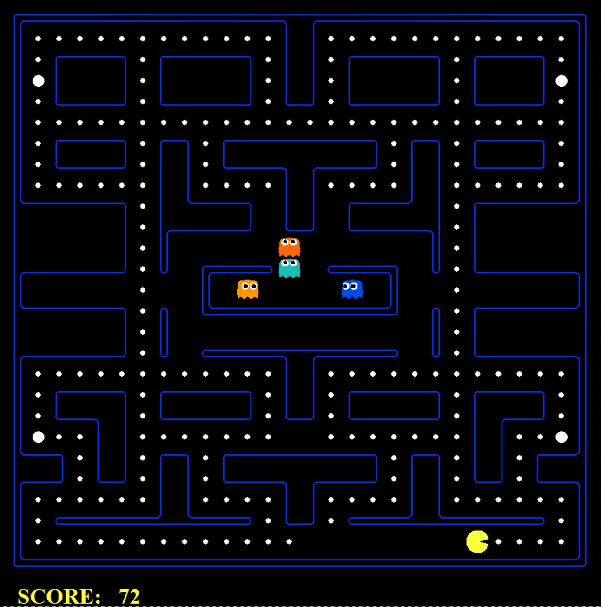
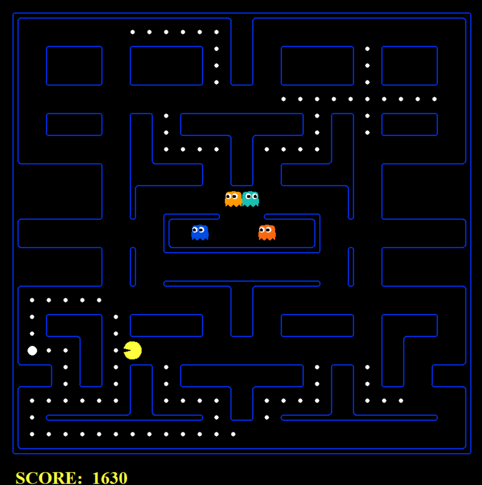

# Pacmov: Agente Autónomo de Pacman utilizando Cadenas de Markov

Implementación de un agente inteligente para el entorno de simulación de Pacman (utilizando las bases de UC Berkeley CS188) basado en Cadenas de Markov de Tiempo Discreto y optimización mediante el criterio del valor esperado.

* Santiago Saldaña Subías A01708446
* Diego Perea León A01708350
* Felipe Pacheco Zamorano A01713238
* Alejandro Flores Martínez A01708363

<p align="center">
  
</p>


---

El agente modela el entorno como un proceso estocástico discreto para predecir el comportamiento dinámico de los fantasmas y tomar decisiones óptimas de navegación bajo incertidumbre.

### Espacio de Estados ($S$)
Discretizamos el mapa descartando muros y obstáculos. Cada celda transitable $(x, y)$ se mapea a un estado discreto $i \in \{0, 1, \dots, N-1\}$, donde:
$$\vert{}S\vert{} = N$$

### Matriz de Probabilidad de Transición ($P$)
Modelamos el movimiento aleatorio de los fantasmas, para cada estado $i$ con $k_i$ vecinos transitables accesibles en una dirección cardinal (N, S, E y O). La probabilidad de transición a un estado vecino $j$ es uniforme:
$$P_{ij} = \mathbb{P}(X_{t+1} = j \mid X_t = i) = \frac{1}{k_i}$$

Si un estado $i$ no posee transiciones libres, se modela como un estado absorbente ($P_{ii} = 1$), donde:
$$\sum_{j \in S} P_{ij} = 1, \quad \forall i \in S$$

### Proyecciones Temporales (Chapman-Kolmogorov)
Para estimar la densidad de probabilidad espacial de los fantasmas en el futuro $m \in \{1, 2, 3\}$, aplicamos las ecuaciones de Chapman-Kolmogorov:
$$P_{ij}^{(m)} = \left(P^m\right)_{ij}$$

Precomputamos las potencias $P^2$ y $P^3$ al inicializar el juego mediante álgebra matricial vectorizada (`numpy`) (para reducir el costo computacional durante el ciclo de ejecución real).

### Matriz BFS
Al inicio se planteó utilizar la distancia Manhattan, sin embargo esta no consideraba paredes. Para evitar mínimos locales, calculamos la distancia mínima real sobre el grafo de adyacencia de $P$:
$$d(i, j) = \text{camino más corto de } i \text{ a } j \text{ sobre } S$$
Utilizamos Breadth-First Search (BFS) para calcular todos los pares de estados en la etapa de preprocesamiento ($O(\vert{}S\vert{} \cdot (\vert{}V\vert{} + \vert{}E\vert{}))$).

### Función de Utilidad y Valor Esperado ($\mathbb{E}[U]$)
Para cada acción legal $a \in \mathcal{A}$, el agente simula el estado sucesor y selecciona la acción que maximiza el valor esperado:
$$a^* = \arg\max_{a \in \mathcal{A}} \mathbb{E}[U(s')]$$

La función de utilidad descompone recompensa y riesgo estocástico:
$$\mathbb{E}[U(s')] = R_{\text{inmediata}}(s') - \alpha \cdot d(s', \text{comida}) + R_{\text{cápsula}}(s') + \mathbb{E}[\text{Riesgo}(s')]$$

* Riesgo Estocástico: Ponderación temporal de colisión con fantasmas activos:
  $$\mathbb{E}[\text{Riesgo}(s')] = C_{\text{muerte}} \sum_{g \in G_{\text{peligro}}} \left( P_{g, s'} + \gamma P^2_{g, s'} + \gamma^2 P^3_{g, s'} \right)$$
* Caza de Fantasmas Vulnerables: Cuando `scared_timer > 3`, (la duración del poder es mayor a 3) el costo de colisión se invierte en una recompensa estocástica positiva.

---

## Estructura del Repositorio

El diseño del modelo es independiente del motor gráfico de simulación de Berkeley (el aporte principal está en markov.py, el resto no es obra propia):

```text
Pacmov/
│
├── markov.py              # Agente estocástico autónomo y toma de decisiones
├── multiagent/            # Motor de simulación y layouts (UC Berkeley CS188)
│   ├── pacman.py          # Bucle principal de ejecución del juego
│   ├── game.py            # Definición de entidades, agentes y tableros
│   └── layouts/           # Archivos de mapas (.lay)
├── .gitignore
└── README.md
```

## Uso

La ejecución del agente se realiza con `markov.py`, el cual procesa los parámetros de configuración y levanta la simulación sin alterar o modificar los archivos originales de Berkeley.

### Sintaxis base

```bash
python markov.py [opciones]
```

---

### Casos de uso comunes

* **Laberinto pequeño:**
  ```bash
  python markov.py -l smallClassic
  ```

* **Laberinto mediano:**
  ```bash
  python markov.py -l mediumClassic
  ```

* **Laberinto completo:**
  ```bash
  python markov.py -l originalClassic --frame_time 0
  ```

* **Evaluación estadística / Benchmark (10 partidas sin interfaz gráfica):**
  ```bash
  python markov.py -l mediumClassic -n 10 -q
  ```

* **Ajuste de escala de ventana (Zoom para pantallas de alta resolución):**
  ```bash
  python markov.py -l smallClassic --zoom 2.0
  ```

---

### Parámetros y banderas disponibles

| Flag | Descripción | Valores por defecto / Ejemplos |
| :--- | :--- | :--- |
| `-l`, `--layout` | Define el laberinto a cargar desde `layouts/`. | `smallClassic`, `mediumClassic`, `originalClassic` |
| `--frame_time` | Tiempo de espera en segundos entre cada cuadro de animación. Se recomienda default en small y medium y 0 en original. | `0.1`, `0.02`, `0` (instantáneo) |
| `-n`, `--num_games` | Número de partidas consecutivas a simular. | `1` (defecto), ej. `-n 20` |
| `-q`, `--quiet_graphics` | Suprime la interfaz gráfica y solo imprime estadísticas finales. | Flag booleano |
| `-z`, `--zoom` | Factor de escala para el renderizado del tablero. | `1.0` (defecto), `1.5`, `2.0` |
| `-g`, `--ghosts` | Clase de comportamiento de los fantasmas rivales. | `RandomGhost`, `DirectionalGhost` |
| `-k`, `--num_ghosts` | Sobrescribe la cantidad de fantasmas en tableros compatibles. | Entero (ej. `-k 2`) |


## Resultados

Usando una muestra de 100 partidas consecutivas en el entorno más difícil (originalClassic):

| Métrica | Valor Obtenido |
| :--- | :--- |
| **Partidas Evaluadas** | 100 |
| **Tasa de Victoria** | **87.0%** |
| **Puntaje Máximo** | 4,057 pts |
| **Puntaje Promedio Estimado** | ~2,890 pts |
| **Puntaje Mínimo** | **40.0 pts** |

<p align="center">
  
</p>
